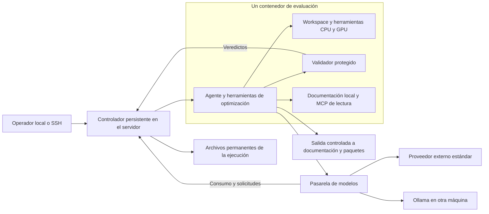

# GTOC-Bench diseño técnico y protocolo experimental

Versión 0.2 · 28 de octubre de 2026

GTOC-Bench evalúa la capacidad de un agente de programación y un modelo de lenguaje para producir soluciones válidas y mejorar su puntuación en problemas GTOC, con un tiempo de cómputo asignado y, opcionalmente, un presupuesto orientativo de tokens. Conserva los candidatos evaluados, el consumo y la evolución de la puntuación para comparar distribuciones de rendimiento, además del mejor resultado.

El proyecto se construirá desde cero. Su primera edición será GTOC 12. El alcance ampliado incluye Codex, Claude Code, OpenHands, SWE-agent y mini-SWE-agent. Los problemas, datos y validadores pertenecerán al repositorio. Una máquina ejecutará una sola evaluación de agente a la vez. Ollama, cuando se utilice, estará en otra máquina y no compartirá las GPU de optimización.

Esta especificación distingue las decisiones fijadas para el benchmark de los valores operativos recomendados. Las interfaces y comandos que aparecen como ejemplos describen la implementación prevista; todavía no constituyen una API implementada.

## Decisiones principales

| Tema | Decisión |
| --- | --- |
| Base de código | Núcleo nuevo; reutilización selectiva de conocimiento y materiales de GTOC 12, sin dependencia de mle-bench ni ALE-Bench. |
| Agentes | Codex, Claude Code, OpenHands, SWE-agent y mini-SWE-agent oficiales, con versiones y adaptadores fijados. Un fork, si se incorporase, tendría identidad propia. |
| Modelos | Configuración independiente del agente y del proveedor, sujeta a pruebas reales de compatibilidad. |
| Razonamiento | Parámetros explícitos y registrados; cambiar de low a max crea otra configuración experimental. |
| Inferencia externa | Servicio estándar. No se emplearán modalidades aceleradas, prioritarias, flexibles o por lotes en la clasificación principal. |
| Hardware | Máquina de optimización dedicada, una evaluación activa y recursos declarados por perfil. |
| Internet | Instalación de bibliotecas y consulta de documentación permitida. Se prohíbe buscar o reutilizar código y soluciones de otros participantes. |
| Bibliotecas | PyTorch y PyKEP preinstalados, junto con las herramientas científicas y de compilación acordadas. |
| Documentación | Copias versionadas cuando sea posible, accesibles por archivos y por un MCP común de lectura. |
| Evaluación | Validador determinista, disponible dentro del contenedor mediante un servicio protegido. |
| Persistencia | Carpetas y archivos como fuente de verdad; SQLite opcional como índice reconstruible. |
| Presupuestos | Tiempo obligatorio; tokens opcionales y orientativos; límite económico opcional como protección adicional. |
| Repeticiones | Campañas con un número configurable de pruebas independientes; veinte es un ejemplo, no un valor fijado. |
| Clasificaciones | Ranking interno de configuraciones agénticas y posición contextual frente a la clasificación histórica. |
| Actividad competitiva | Excluida de la puntuación y de las métricas. En GTOC 12 se utiliza Bᵢ = 1. |
| Recuperación | Reintentos acotados y conservación continua. Las continuaciones que descuentan pausas se distinguen de las ejecuciones con tiempo continuo. |

## Objetivo y alcance

La unidad de evaluación es una configuración completa: agente, versión del agente, modelo, proveedor, parámetros de razonamiento, entorno, hardware, reglas del problema y presupuesto. Un nombre comercial de modelo no basta para identificar una fila del ranking.

La pregunta experimental es cuánto mejora esa configuración una solución de GTOC mientras consume tiempo y tokens. No se evalúa únicamente si logra una solución válida, ni se obliga al agente a utilizar una estrategia, un lenguaje o un optimizador determinados.

La primera versión incluirá ejecución local de desarrollo y ejecución oficial en servidores Linux, registro completo, análisis de una edición y campañas secuenciales. El diseño permitirá incorporar nuevas ediciones mediante paquetes de problema. No incluirá Kaggle, otros concursos, agentes fuera del alcance declarado, un planificador distribuido, Kubernetes ni un servicio central de base de datos. El README distingue qué partes ya están implementadas y cuáles siguen pendientes.

Se distinguen tres usos:

- **Desarrollo:** pruebas cortas, depuración, cambios de configuración y continuaciones manuales. No entran en la clasificación oficial.
- **Evaluación oficial:** configuración congelada, política de red y recursos aplicada, historial completo y protocolo experimental definido antes del comienzo.
- **Continuación de investigación:** recuperación de trabajo interrumpido para seguir explorando, identificada por su relación con la ejecución original y por sus condiciones de reanudación.

## Qué se conserva de las revisiones anteriores

De mle-bench se conserva la conveniencia de distribuir resultados como directorios inspeccionables y de separar el agente del problema. Se elimina la infraestructura de Kaggle, sus convenciones de entrega, los agentes ajenos al alcance y sus dependencias.

De ALE-Bench se adoptan los resultados estructurados, la independencia entre evaluador y estrategia, la consulta de detalles bajo demanda, la visualización separada de la puntuación y las pruebas de errores de almacenamiento. No se heredan su modelo de programas sobre casos públicos y privados, los contenedores por caso ni las rondas de generación de su ejecutor.

El almacenamiento temporal de un MCP y el archivo permanente de un experimento tendrán responsabilidades distintas. Los datos que consulta el agente pueden paginarse o resumirse; los candidatos y veredictos oficiales no caducarán por esas políticas de presentación. Esta distinción responde al comportamiento de la [capa MCP de ALE-Bench](https://github.com/SakanaAI/ALE-Bench/blob/8ba16e6baf743aa8736516c45d1c52afdbd4de99/docs/mcp_server.md).

## Arquitectura y límites de confianza

El controlador se ejecuta en el servidor de optimización y continúa aunque el cliente SSH se desconecte o el ordenador del operador entre en reposo. Posee el reloj, el ciclo de vida de la ejecución y el registro permanente.

El agente ejecuta código libremente dentro de su espacio asignado, sin privilegios administrativos sobre el contenedor ni el host. El servicio de validación comparte el contenedor de evaluación, pero utiliza otra identidad de sistema, archivos protegidos y un canal propio hacia el controlador.

La pasarela de modelos está fuera del espacio modificable por el agente. Custodia las credenciales reales, aplica la configuración del proveedor y registra las solicitudes. La salida hacia documentación y paquetes se controla también fuera del agente.



Estos son límites de responsabilidad, no una obligación de desplegar microservicios. El controlador, la contabilidad y parte de las interfaces pueden pertenecer al mismo proceso del host. No se requiere un contenedor adicional por cada componente.

El esquema representa las modalidades con pasarela. En el perfil de suscripción
Claude, el cliente oficial y el servidor MCP forman parte de los componentes
confiables del host: el cliente consulta directamente a Anthropic y el MCP solo
ejecuta herramientas dentro del contenedor. El código propuesto por el modelo
sigue siendo no confiable. Esta diferencia se identifica en el manifiesto.

### Protección del host y del evaluador

El perfil oficial debe cumplir estas condiciones:

- Agente sin root ni sudo, sin modo privileged, sin socket Docker, sin acceso al agente SSH ni a credenciales del operador.
- Capacidades Linux eliminadas salvo necesidad justificada, prohibición de adquirir nuevos privilegios y política de llamadas al sistema compatible con las herramientas científicas.
- Imagen y materiales oficiales de solo lectura. Escritura restringida a workspace, entorno de usuario y temporales con cuotas.
- Límites de memoria, procesos, disco y salida, manteniendo el acceso a las CPU y GPU declaradas para optimización.
- El usuario del agente no puede modificar, enviar señales ni depurar los procesos protegidos del validador.
- El registro oficial se escribe desde componentes confiables. El agente no tiene acceso de escritura a sus manifiestos, eventos ni veredictos.
- El estado de la sesión, los límites y las reglas no pueden cambiarse mediante las herramientas expuestas al agente.

Los datos, instrucciones y páginas descargadas son material no confiable. No autorizan nuevas conexiones, cambios de presupuesto ni acceso a secretos.

El validador también procesa entradas no confiables: se ejecuta sin privilegios, con límites de recursos y sin salida general a Internet. Su canal hacia el controlador solo admite las operaciones y archivos de la ejecución asignada. El servicio de documentación comprueba los destinos después de resolver nombres y redirecciones; no se utiliza como proxy arbitrario hacia la LAN o el host.

Docker comparte el kernel del host y la exposición de GPU añade una superficie que debe verificarse. La evaluación oficial se hará en servidores dedicados y sin otros datos sensibles accesibles. Un aislamiento adicional mediante máquina virtual puede incorporarse si el entorno lo requiere; no se afirmará que los contenedores eliminan todo riesgo de escape.

### Internet y documentación permitida

El perfil inicial de red será `docs_and_packages`. Permitirá documentación general de las bibliotecas y herramientas, y sus canales de distribución aprobados. La inferencia del modelo se realizará exclusivamente a través de la pasarela asignada.

Se prohíben expresamente la búsqueda de código de participantes, las soluciones completas, los repositorios de soluciones GTOC, el intercambio con otras ejecuciones y la externalización de la optimización a máquinas o servicios no asignados. Una solución histórica no pasa a estar permitida porque se publique como paquete, tutorial o ejemplo de documentación.

La política se aplicará mediante un catálogo versionado de destinos, rutas y paquetes permitidos, salida de red restringida y registro de descargas. Para la documentación, un servicio de lectura puede recuperar las páginas autorizadas y devolver su contenido; para paquetes se utilizarán registros o un proxy controlado. Un túnel HTTPS abierto a todo GitHub no permite hacer cumplir restricciones por ruta y no será la política inicial.

La red del agente no tendrá acceso general a la LAN, al host ni a servicios de metadatos. La excepción necesaria para Ollama la posee la pasarela, hacia el endpoint configurado; el agente no obtiene acceso directo al servidor de inferencia. Se desactivarán búsquedas web globales y herramientas de búsqueda alojadas por el proveedor cuando no puedan someterse a esta política.

El catálogo y los controles se fijan antes de la campaña. No se amplían manualmente para ayudar a una ejecución concreta. Se registrarán URL, paquete, versión y hash cuando estén disponibles, evitando guardar cabeceras de autorización. Estos controles reducen oportunidades de reutilización y permiten auditoría; no demuestran ausencia de contenido memorizado en el entrenamiento del modelo.

## Agentes, modelos y proveedores

### Versiones oficiales y código filtrado

Se puede comparar una versión congelada de Claude Code. La opción elegida es fijar una distribución oficial verificable, conservar su versión y hash y desactivar las actualizaciones. La documentación de Anthropic contempla instalación de versiones concretas y controles de actualización. Una versión antigua se identifica como tal y no representa automáticamente el rendimiento del agente actual. [Instalación y versiones de Claude Code](https://code.claude.com/docs/en/setup)

La filtración difundida el 31 de marzo de 2026 no se adopta como base del proyecto. Su disponibilidad no acredita permiso para modificar y redistribuir un fork: el repositorio oficial declara derechos reservados y remite a sus condiciones comerciales. Un fork autorizado tendría que registrar procedencia, licencia, cambios y nueva identidad; no se presentaría como equivalente a la distribución oficial. [Información sobre el incidente](https://www.infoq.com/news/2026/04/claude-code-source-leak/) y [licencia de Claude Code](https://github.com/anthropics/claude-code/blob/main/LICENSE.md)

Se fijan por campaña las distribuciones de todos los agentes, su configuración, instrucciones, herramientas, extensiones y comportamiento de actualización. El código instalado no será modificable por el usuario del agente. Cambiar cualquiera de estos elementos relevantes crea otra configuración.

### Separación de componentes

Un adaptador de agente tiene pocas responsabilidades: preparar la configuración, lanzar el cliente en modo no interactivo, recoger sus eventos, comunicar el estado del presupuesto y, cuando esté soportado, reabrir una conversación conservada.

Un adaptador de proveedor resuelve autenticación, protocolo, streaming, consumo, errores y selección del nivel de servicio. No decide estrategias de optimización ni modifica respuestas para mejorar su calidad.

### Autenticación mediante suscripción a ChatGPT

Además de `api_key`, se admite `auth_method: chatgpt` para los seis agentes mediante el flujo
oficial Sign in with ChatGPT para aplicaciones locales. La autorización OAuth
con PKCE, la verificación de identidad y la renovación pertenecen al controlador.
El agente sigue utilizando la pasarela local con una credencial sin valor fuera de
la evaluación; no se monta su sesión personal ni se mantiene un fork del agente.
[Flujo oficial](https://developers.openai.com/siwc/token-sharing-open-source/sign-in)

Cada perfil conserva por separado el cliente registrado, la identidad validada y
los tokens, en archivos privados fuera del repositorio. El host tiene un
identificador estable. La rotación se serializa entre procesos y una ejecución
fija su perfil y sesión: no hay alternancia entre cuentas, modelos ni API keys.
Un resultado ambiguo al renovar exige una nueva autorización, evitando reutilizar
un refresh token que podría haberse consumido.

Esta modalidad utiliza el endpoint público Responses y el catálogo de la cuenta.
Se registran autenticación, perfil, referencia opaca de cuenta y modalidad de
facturación como condiciones de la ejecución. El coste real queda sin determinar;
no se considera gratuito ni se calcula aplicando automáticamente precios API.
Suscripción y API son condiciones diferenciadas al comparar resultados.

El servicio exige streaming y no admite `max_output_tokens`: la configuración
rechaza un techo de salida explícito y conserva el límite orientativo de tokens
de toda la ejecución. Los errores terminales dentro del stream se registran,
aunque el estado HTTP sea 200. La renovación no altera presupuestos ni reanuda
ejecuciones interrumpidas. El acceso depende de la disponibilidad del servicio
en preview y de los permisos de la cuenta.

Codex conserva el protocolo Responses. Para los otros clientes, la fase de
desarrollo incorpora `chatgpt-responses-v1`: traduce Anthropic Messages o Chat
Completions al endpoint público Responses. Solo admite texto y funciones
locales; conserva resultados de herramientas y razonamiento cifrado entre
llamadas dentro de la ejecución. No modifica los clientes ni decide acciones.
La contabilidad procede siempre de los eventos originales del proveedor.

La conversión entrega la respuesta completa al terminar la inferencia, incluso
si el cliente solicita streaming. Esta diferencia de latencia se registra
junto al protocolo y a los parámetros efectivos. Las funciones de compactación
remota, conteo previo de Anthropic y entradas multimodales quedan fuera de esta
adaptación. Se considera un perfil experimental, distinto del protocolo nativo
con API key, hasta validar las funciones necesarias para una campaña completa.

### Antigravity como agente y proveedor experimental

Se incorpora el agente `antigravity` mediante el SDK oficial 0.1.23 y su runtime,
sin implementar otro bucle de decisiones. La inferencia usa Chat Completions por
la pasarela del bench; agente y fabricante del modelo son independientes. El
perfil habilita herramientas nativas de terminal y archivos, sin subagentes ni
web/imágenes. La imagen contiene runtimes de esa misma versión para x86 y ARM;
se registra el host y la imagen concreta. Es un perfil SDK, distinto del IDE/CLI.

Se registran los pasos públicos y la causa de parada del SDK. Si su turno termina
sin una respuesta final completada, con causa no especificada y sin error fatal,
se permiten como máximo dos recuperaciones neutrales en la misma conversación.
Los mensajes y su consumo quedan registrados; no se repiten herramientas ni se
extiende una finalización voluntaria. Un cierre incompleto persistente produce
`agent_runtime_interrupted`, estado `interrupted`, conservando el checkpoint y
el presupuesto restante. La recuperación de un cierre antiguo clasificado como
`agent_finished` exige una causa explícita del operador y crea una continuación
de investigación sin modificar los artefactos originales.

El acceso a la cuota y catálogo de Antigravity desde otros agentes se declara
separadamente como `auth_method: antigravity`. Usa CLIProxyAPI 8.0.47, fijado por
SHA-256 y ejecutado en el host, con una sola cuenta privada, administración
deshabilitada, escucha local y reintentos/cambio de modelo/créditos desactivados.
Se distingue del acceso oficial: Google no autoriza reutilizar la cuota de
suscripción en clientes de terceros. [FAQ de Google](https://antigravity.google/docs/faq)

La selección requiere un ID anunciado por el catálogo de la cuenta, sin filtro
de fabricante ni sustitución automática. El manifiesto registra el puente, su
hash, perfil e identidad opaca. Los tokens son reportados por el puente; el
bench no acredita la contabilidad original ni el servicio estándar aplicado
internamente. Esas limitaciones se conservan como condiciones experimentales y
no se convierten en coste API verificado. La política de ranking y las futuras
campañas deben distinguir este perfil de conexiones nativas.

### Suscripción de Claude y cliente oficial

Se incorpora `auth_method: claude_subscription` exclusivamente para Claude Code.
La política publicada por Anthropic reserva las credenciales de suscripción a
sus aplicaciones nativas y no autoriza ofrecerlas como backend de otros agentes.
Se conserva el binario oficial sin modificaciones y su propio flujo de login;
no se extraen, almacenan ni intermedian tokens desde el controlador.
[Condiciones de autenticación](https://code.claude.com/docs/en/legal-and-compliance#authentication-and-credential-use)

En este perfil, el cliente oficial está en el host. La autenticación y renovación
permanecen bajo su control, con un perfil privado fuera del repositorio y de los
resultados. El bench delega `auth login/status/logout`. El perfil se bloquea
durante la evaluación y no hereda claves API ni proveedores del entorno del
operador. No hay fallback a facturación API.

Claude se ejecuta con `--restricted`, sin herramientas incorporadas, hooks,
instrucciones personales ni MCP adicionales. La única herramienta habilitada
es un servidor MCP local que admite comandos y tiempos de espera y ejecuta
como UID 1000 dentro del contenedor. El modelo no selecciona argumentos Docker,
montajes ni rutas de host. La imagen, el evaluador, la política documental y el
reloj son los mismos que en los otros perfiles. Un supervisor termina el cliente
del host cuando el controlador desaparece; el supervisor del contenedor termina
los procesos de optimización.

El perfil se identifica como `official_cli_container_tools`. Su consumo se mide
por eventos del CLI, deduplicando mensajes y reconciliando totales finales. Las
peticiones sin cierre conservan incertidumbre. Razonamiento y modo estándar se
configuran en el cliente; no se intercepta HTTPS para verificarlos. Cambios de
modelo o de velocidad observables detienen el run. Los reintentos observables se
limitan y consumen tiempo; un fallo terminal conserva los resultados y no crea
automáticamente un intento nuevo. El coste real de suscripción no se infiere
del coste API estimado que pueda emitir el cliente.

Se comparan por separado este perfil y el de Claude con API key: disponer de una
herramienta MCP de shell en lugar de sus herramientas incorporadas es una
condición experimental relevante. Las políticas administradas de la máquina
siguen siendo aplicables al cliente oficial; el servidor de campaña deberá
tenerlas controladas. Las pruebas con proveedor simulado no sustituyen una
comprobación de login, cuota y modelos con la cuenta real.

### Adaptadores de OpenHands y SWE

OpenHands usa el bucle oficial del SDK y el agente, herramientas y condensador
del CLI fijado, sin descargar skills públicas en el arranque. Su registro de
capacidades determina el protocolo; la configuración debe coincidir con él.
Los modelos posteriores pueden requerir actualizar ese adaptador y constituyen
una nueva configuración experimental.

SWE-agent usa su bucle oficial y SWE-ReX en modo local dentro del único
contenedor. No monta un socket Docker ni crea contenedores adicionales. Su
estado interno en `/root` se aloja en un temporal propiedad del UID 1000; el
nombre de la ruta no concede privilegios. Un bundle mínimo proporciona `finish`
para terminar sin exigir un parche Git; no puntúa ni registra soluciones.
mini-SWE-agent utiliza su agente, modelo LiteLLM y entorno local oficiales.
Ambos reciben un enunciado general de optimización en lugar de una plantilla
de reparación de repositorios. Los tres usan dependencias Python fijadas y
separadas de PyKEP/PyTorch, y sus llamadas pasan por la pasarela con API key.

### Compatibilidad de proveedores

Codex documenta proveedores configurables y parámetros de razonamiento. La compatibilidad se comprueba contra la versión fijada, no únicamente por el nombre del modelo. [Referencia de configuración de Codex](https://learn.chatgpt.com/docs/config-file/config-reference)

El preflight de Codex consulta el catálogo y resuelve una conversación efímera
con el binario fijado, sin iniciar ningún turno de inferencia. Un modelo sin
metadatos reconocidos no puede empezar utilizando un respaldo silencioso. El
catálogo completo del proveedor, o uno explícito del operador, se fija y conserva
con su hash; se registran ventana de contexto y política de compactación. Un
umbral de compactación no declarado conserva el predeterminado del cliente y
queda identificado así, sin inventar un valor numérico.

Ollama documenta integraciones con ambos clientes. Esto permite probar modelos locales sin basar el benchmark en una filtración. No garantiza que todas las herramientas o modalidades de razonamiento funcionen con cualquier modelo. [Codex con Ollama](https://docs.ollama.com/integrations/codex) y [Claude Code con Ollama](https://docs.ollama.com/integrations/claude-code)

Se contempla esta matriz de compatibilidad:

| Cliente | Destino | Tratamiento |
| --- | --- | --- |
| Codex | Proveedor con protocolo admitido por esa versión | Adaptación de configuración y comprobación completa de herramientas y uso. |
| Claude Code | Endpoint compatible con su protocolo | Configuración del gateway y comprobación completa. |
| Claude Code oficial | Suscripción Claude | Cliente nativo en el host y herramientas MCP en el contenedor; sin reutilización en otros agentes. |
| OpenHands | Responses, Chat Completions o Anthropic Messages | SDK oficial, según las capacidades del modelo de su versión fijada. |
| SWE-agent / mini-SWE-agent | Chat Completions o Anthropic Messages | Clientes LiteLLM nativos y pasarela de credenciales y consumo. |
| Ambos | Ollama en la máquina de inferencia | Perfil específico, modelo y versión de servidor fijados. |
| Cliente y proveedor con protocolos diferentes | Adaptador de traducción | Experimental hasta superar pruebas de equivalencia de mensajes, herramientas, errores y contabilidad. |

No se promete el producto cartesiano de todos los agentes y todos los modelos. Una combinación sin compatibilidad suficiente se declara `unsupported`, con el motivo. Puede evaluarse un adaptador existente y mantenido antes de desarrollar uno propio; la versión del adaptador forma parte del experimento.

### Razonamiento y tareas auxiliares

Cada ejecución registra tanto la configuración solicitada como los campos realmente enviados al proveedor: esfuerzo de razonamiento, modalidad de thinking, presupuesto específico de thinking cuando exista, máximo de salida, temperatura, top-p, contexto y política de compactación.

No se presupone que low, high o max tengan el mismo significado entre proveedores. Un parámetro no soportado provoca un error de preparación; no se descarta silenciosamente. Se conserva el valor nativo además de cualquier etiqueta de presentación.

La clasificación principal representa una configuración homogénea de agente y modelo. Las llamadas de compactación, los subagentes nativos y las tareas auxiliares deben utilizar el modelo declarado o quedar identificadas en un mapa explícito. Si el cliente requiere otros modelos, la combinación se etiqueta como sistema compuesto y se separa del ranking homogéneo. Todas sus solicitudes consumen el presupuesto de la ejecución.

La concurrencia de solicitudes se declara y registra. El valor inicial recomendado es una solicitud de modelo en vuelo, por simplicidad operativa; se podrán comparar otros valores como configuraciones distintas. Esto no limita el paralelismo del código de optimización dentro de los recursos de la máquina.

### Inferencia estándar

El benchmark exige la modalidad estándar de cada proveedor. La pasarela configura el campo correspondiente y registra el nivel efectivo cuando se devuelve. En OpenAI, `service_tier=default` selecciona precio y rendimiento estándar; dejar `auto` puede heredar otra configuración del proyecto. En Anthropic, `standard_only` evita el uso de capacidad prioritaria. [Referencia de OpenAI](https://developers.openai.com/api/reference/cli/resources/responses/methods/create) y [niveles de servicio de Anthropic](https://platform.claude.com/docs/en/api/service-tiers)

También se desactivarán las opciones de aceleración propias del cliente. Para otros proveedores, el adaptador deberá documentar y verificar la equivalencia antes de admitir resultados oficiales. Un cambio silencioso de nivel o modelo invalida la pertenencia a la configuración declarada.

Servicio estándar no significa velocidad idéntica ni constante. Se registran latencia hasta el primer token, duración, tokens de salida, región conocida, límites de tasa y proveedor efectivo. No se añade una espera artificial para igualar velocidades.

### Credenciales y límites económicos

El operador mantiene un archivo `.env` por proveedor fuera del repositorio y de los volúmenes del agente, con permisos restringidos. La pasarela carga únicamente las credenciales necesarias. Los manifiestos contienen el identificador de la configuración de credenciales, nunca la clave, el contenido del archivo ni un volcado completo del entorno.

El agente recibe una credencial efímera, limitada a su ejecución, endpoint y configuración, revocable al terminar. Esta credencial no permite administrar claves, modificar presupuestos o elegir otro proveedor. Los registros de solicitudes eliminan secretos antes de persistirlos.

Se admite un límite económico adicional cuando el proveedor lo soporte. No todos lo aplican por clave: puede corresponder a una clave, proyecto, workspace u organización. La documentación actual de OpenAI permite límites mensuales duros de proyecto u organización y distingue esos controles de las alertas; advierte que su aplicación puede admitir un pequeño exceso. Una clave de un proyecto dedicado puede aprovechar ese control. [Límites de gasto de OpenAI](https://developers.openai.com/api/docs/guides/spend-limits)

La creación de credenciales y la administración de presupuestos serán tareas del operador. La primera versión no necesita poseer claves administrativas para automatizarlas. Un límite del proveedor complementa el control local; no sustituye el reloj ni la contabilidad y no equivale a un límite exacto de tokens.

Si se agota el límite económico asignado expresamente a la prueba, el resultado es `cost_limit`. No se reanuda automáticamente con otra clave para eludirlo. Si se agota una cuota externa compartida no prevista, se trata como incidencia del proveedor.

## Entorno científico y hardware

La imagen común tendrá Python, NumPy, SciPy, PyTorch, PyKEP y las herramientas de compilación y shell necesarias. Cada agente añade su cliente sobre esa base. Las versiones concretas se seleccionarán mediante una prueba de compatibilidad y quedarán fijadas por receta, archivo de dependencias y digest de imagen.

No se instalará la última versión disponible al comenzar cada prueba. La instalación de PyKEP y la combinación de PyTorch, Python, CUDA y controladores se comprobarán como un conjunto. Se utilizarán las distribuciones oficiales y las indicaciones de instalación de [PyKEP](https://github.com/esa/pykep) y [PyTorch](https://docs.pytorch.org/get-started/locally/).

Se podrán añadir paquetes durante una ejecución a un entorno escribible del agente. Ese tiempo cuenta contra el presupuesto y la instalación se registra. El agente no puede sustituir el entorno protegido del validador.

### Documentación y MCP

Un único servicio de documentación ofrecerá operaciones equivalentes a `docs.search(library, query)` y `docs.read(document_id, range)`. Se alimenta de documentación versionada compatible con las bibliotecas instaladas. Devuelve la fuente, versión y fragmento consultado; no genera respuestas mediante otro LLM ni introduce consumo oculto.

No se exige que PyTorch, PyKEP o cada biblioteca futura publique su propio MCP. Se pueden incorporar sus documentos al catálogo común. Si existe un MCP oficial adecuado, podrá conectarse después de revisar sus operaciones, destinos y versiones; no obtiene acceso al controlador ni a credenciales por el hecho de ser un MCP.

La misma documentación se podrá leer mediante archivos o CLI. Los clientes con distinto soporte MCP dispondrán del mismo contenido autorizado. Los ejemplos que contengan soluciones de participantes se excluirán del corpus aunque pertenezcan a la documentación de una biblioteca.

### Perfiles de máquinas

El controlador detecta y registra CPU física y lógica, memoria, GPU y VRAM, UUID o particiones de GPU, controladores, entorno CUDA, sistema operativo, arquitectura, runtime de contenedores y límites realmente aplicados.

Un perfil oficial declara los recursos disponibles. Cada contenedor de evaluación
tiene un máximo de **32 CPU lógicas**, contando los hilos SMT como CPU distintas.
Por defecto `hardware.cpus` es 32 y se asigna el mínimo entre ese valor y las CPU
disponibles en el runtime. Se pueden configurar límites inferiores; valores
superiores a 32 se rechazan. `cpus: null`, admitido por compatibilidad, también
respeta el máximo. El controlador aplica siempre `--cpus` al crear el contenedor,
incluidos lanzamientos antiguos pendientes o continuaciones. Es una cuota total
de tiempo de CPU compartida por todos los procesos del contenedor, incluido el
validador; no fija afinidad ni garantiza 32 núcleos físicos exclusivos. Se conserva
la afinidad disponible y se registra la cuota efectiva del cgroup. Los perfiles de
hardware siguen distinguiendo máquinas, arquitectura y SMT.

La política GPU por defecto es `hardware.gpus: auto`: detectar NVIDIA en el host
y asignar todas las disponibles. `none` desactiva GPU explícitamente y `all`
exige que existan. Con `environment.image: auto` se selecciona la imagen CPU o
CUDA apropiada; una imagen explícita queda sujeta a la misma comprobación de
acceso. Antes del reloj se verifica un cálculo en cada GPU como el usuario del
agente, no solo la presencia de `nvidia-smi`. Si el driver, el runtime o la imagen
impiden usar una GPU detectada, se registra un error de preparación; no se
degrada silenciosamente a CPU. Se conservan UUID, modelo, VRAM, versión CUDA y
resultado del preflight, y el agente recibe el inventario en su prompt y estado.
La implementación amd64 actual no habilita CUDA mediante emulación x86 en ARM.
Las continuaciones conservan la asignación GPU observada; añadir GPU implica
una prueba independiente. La excepción de desarrollo `concurrent_with` exige
CPU explícita hasta disponer de asignaciones GPU disjuntas.

La memoria y las GPU se asignan según el perfil. El agente podrá utilizar todos
los recursos asignados dentro de ese techo de CPU. Un bloqueo exclusivo impide
iniciar otra evaluación mientras la primera siga activa; el techo no autoriza
usar el resto de la máquina para otra evaluación. La auditoría conserva recursos
solicitados, CPU del runtime, límite efectivo y máximo del benchmark. El cambio
se aplica a los contenedores nuevos, sin modificar pruebas que ya estén activas.
El límite efectivo se comunica en el prompt inicial y mediante `cpu_limit` en
`gtoc status --json`, para elegir trabajadores/hilos sin confundir CPU visibles
con cuota asignada.

El preflight verifica GPU, importaciones, funcionamiento del validador y espacio de disco antes de mostrar el problema. La carga de imágenes, instalación base y comprobaciones neutrales quedan fuera del cronómetro; la lectura del problema, las instalaciones adicionales, las compilaciones y la optimización quedan dentro.

Ollama se ejecuta en otra máquina. Se registra por separado su hardware, versión, modelo por digest, cuantización, contexto, opciones de generación y concurrencia. Se recomienda precargar el modelo antes de iniciar el reloj y mantener el servidor sin trabajos de inferencia ajenos a la campaña. Se permite conservar los pesos cargados, pero no conversaciones ni resultados de pruebas anteriores.

Las comparaciones principales de tiempo se hacen dentro del mismo perfil de optimización y condiciones de inferencia declaradas. Las máquinas distintas generan grupos comparativos distintos. Las pruebas locales en macOS, emulación o equipos compartidos se identifican como desarrollo salvo que se defina expresamente un perfil experimental para ellas.

## Problemas y validación

Cada edición aporta un paquete autocontenido:

```text
problems/gtoc12/
  problem.yaml
  statement.md
  instructions.md
  data/
  validator/
  documentation/
  reference/
```

`problem.yaml` declara identificador y revisión, sentido de optimización, unidad de puntuación, formato de solución, límites de tamaño y duración de validación, versiones y hashes de los materiales. Las tolerancias numéricas pertenecen a la revisión del validador y no son parámetros elegibles por el agente.

El repositorio contiene tanto los materiales del participante como las referencias del operador, pero el contenedor recibe solo una exportación explícita del paquete. No se monta el repositorio completo, su historial Git, otros experimentos, soluciones históricas ni fixtures que revelen soluciones completas.

Las instrucciones comunes explican recursos, presupuesto, política de Internet y cómo registrar soluciones. No sugieren una estrategia de búsqueda ni obligan a resolver el problema en un único archivo Python. Las adaptaciones al concurso original se indican de forma visible y prevalecen sobre los apartados originales modificados.

### GTOC 12 inicial

Se conserva la variante estática del artículo: Bᵢ = 1 y puntuación igual a la masa total entregada conforme a las reglas del problema. No se incorporan coeficientes derivados de otros participantes, decaimiento por actividad ni mecánicas competitivas. Las restricciones físicas y de flota siguen siendo parte de la validez.

Se extraerán del legado únicamente datos, enunciado adaptado, documentación necesaria y validador. El binario Linux x86-64 disponible se fijará por hash y se comprobará con casos conocidos; no se prometerá compatibilidad con otras arquitecturas sin verificarla. La procedencia y los derechos de distribución de los materiales se documentarán.

La evaluación declarada como determinista deberá confirmarse repitiendo candidatos y verificando tolerancias en las plataformas admitidas. La búsqueda del agente puede ser estocástica aunque el veredicto sobre un archivo fijo sea determinista.

### Contrato de evaluación

La operación inicial será `gtoc evaluate ruta/solucion.txt --json`. Validar mediante esta operación también registra el candidato; el agente no necesita ejecutar un segundo envío para conservar un resultado válido.

El CLI transmite bytes al servicio protegido. No se permite que el servicio abra rutas arbitrarias del host. El resultado contiene al menos:

```json
{
  "submission_id": "identificador-unico",
  "status": "valid",
  "score": 123.45,
  "score_unit": "kg",
  "artifact_sha256": "hash-del-archivo-evaluado",
  "problem_revision": "gtoc12-static-v1",
  "validator_revision": "version-y-hash",
  "received_elapsed_seconds": 742.1,
  "validation_seconds": 0.4,
  "diagnostics": [],
  "details_ref": "submissions/identificador-unico/report.txt"
}
```

Los estados distinguen `valid`, `invalid`, `validator_error` y `rejected`. Un código de salida inesperado, un timeout o una respuesta que no se puede interpretar no se convierten en una solución válida ni en una puntuación inventada. Se conservan las salidas originales junto con el veredicto estructurado. NaN e infinito no son puntuaciones admisibles.

El registro captura una copia inmutable del candidato antes de validarlo. Esa copia, su hash y la revisión del juez identifican exactamente el resultado. Si el agente cambia después el archivo original, el resultado no cambia.

Cada invocación completada por el servicio queda registrada, válida o inválida, mejore o no el máximo. Si los bytes ya se evaluaron con la misma revisión, puede reutilizarse el veredicto determinista, manteniendo un nuevo evento de consulta y el primer instante en que se obtuvo el resultado.

El benchmark no puede descubrir todas las soluciones que un programa mantiene en memoria o evalúa con una función privada. Las instrucciones exigirán presentar los candidatos que se quieran reconocer oficialmente. Las estimaciones locales no cuentan como veredictos hasta pasar por el servicio.

### Envíos próximos al límite

El instante oficial de recepción lo fija el controlador cuando los bytes completos y el evento de aceptación están persistidos. No se utiliza la fecha del archivo proporcionada por el agente.

Solo se aceptan candidatos recibidos antes del corte. Un candidato aceptado puede terminar de corregirse después, sin devolver información ni conceder cómputo adicional al agente. Si el contenedor ya se ha cerrado, se utiliza el mismo validador en una comprobación aislada posterior y secuencial. No hay dos evaluaciones de agente simultáneas.

Se limita el tamaño de los archivos y, inicialmente, se admite una única evaluación pendiente. No se acepta una cola ilimitada de archivos en el último segundo. El tiempo del validador durante la ejecución consume recursos de la misma máquina y el reloj de la prueba sigue avanzando.

## Tiempo, tokens y presupuesto visible

### Relojes

El tiempo de una misión simulada en GTOC es distinto del tiempo que tiene el agente para resolver el problema. El límite experimental controla el segundo.

El perfil oficial inicial recomendado es `continuous_wall`: el reloj empieza cuando el agente puede acceder por primera vez al problema y avanza durante razonamiento, inferencia, herramientas, instalaciones, compilación, validación y esperas. Se mide con un reloj monotónico del host. Los eventos incluyen también UTC para auditoría.

Se registra por separado la duración de preparación, inferencia, herramientas, validación, espera por proveedor y parada operativa. Las duraciones pueden solaparse cuando hay trabajo concurrente y no deben sumarse sin tenerlo en cuenta.

Una desconexión SSH no afecta al reloj. Un reinicio del host tampoco reinicia el presupuesto: el controlador detecta el cambio de arranque, conserva los registros y marca la interrupción. La recuperación no convierte automáticamente ese intento en una ejecución continua válida.

### Tokens orientativos

El presupuesto opcional se basa en tokens de entrada más tokens de salida, contando las llamadas reales de toda la ejecución. Las lecturas de caché forman parte del trabajo de entrada; su descuento económico se calcula aparte. Los tokens de razonamiento se registran sin sumarlos dos veces si ya están incluidos en la salida del proveedor.

Cada adaptador transforma el uso nativo a campos comunes y conserva los datos originales. Se distinguen consumo reportado, estimado y desconocido. Un stream interrumpido sin uso final no equivale a consumo cero.

La pasarela comprueba el total al admitir solicitudes y al recibir información de uso. Al detectar que se ha alcanzado el umbral, cierra nuevas solicitudes y termina el trabajo del agente. Las solicitudes en vuelo y el retraso de la información pueden producir un exceso: se conserva el consumo real conocido y el exceso observado, sin ocultarlo ni presentar el límite como exacto.

El corte cancela activamente las operaciones de inferencia pendientes antes de
esperar la finalización de validaciones y registros. La implementación de la
pasarela emplea transporte HTTP asíncrono cancelable, con observación del
presupuesto independiente de la llegada de datos. También se interrumpen las
esperas de conexión, cabeceras y reintentos. La auditoría separa la solicitud de
cancelación y el cierre local observado; no afirma una confirmación de parada
o facturación del proveedor. En la modalidad oficial de suscripción de Claude,
se registra la solicitud de parada y la terminación del cliente oficial. Nunca
se sustituye un total de tokens desconocido por un cero confirmado.

No se requiere una reserva exacta de tokens por solicitud. Se puede limitar la salida máxima y la concurrencia para contener el exceso. El máximo de salida de una llamada, el contexto del modelo, la cuota de tokens por minuto y el presupuesto acumulado de la ejecución son controles distintos.

Los tokens no representan la misma cantidad de texto o cómputo entre tokenizadores. Las curvas por tokens son útiles, pero se acompañan de tiempo, coste y procedencia del conteo.

### Corte y estado visible

La ejecución termina al llegar al límite temporal, al detectarse el umbral de tokens, al agotarse el límite económico configurado o por otra causa terminal registrada. Se cierra la admisión de candidatos, se revoca el acceso al modelo y se detienen todos los procesos del agente, incluidos los optimizadores secundarios. La conservación de resultados no depende de una última acción del agente.

Durante el cierre se intentan cancelar las solicitudes en vuelo y se reconcilia el uso que llegue después del corte. Revocar la credencial local no garantiza que el proveedor haya detenido una generación ya aceptada. Los cargos o tokens tardíos quedan asociados al intento original; cuando no se puedan recuperar, el informe conserva esa incertidumbre.

El host expone `gtoc status --json` y una vista de solo lectura actualizada. Incluye tiempo transcurrido y restante, límite de tokens, consumo conocido y estimado, solicitudes en vuelo, mejor puntuación, causa de parada y estado del proveedor. Sin límite de tokens, los campos correspondientes muestran `null`, no un número ficticio.

Las respuestas de evaluación incluyen un resumen de presupuesto. Los adaptadores pueden añadir recordatorios de estado mediante mecanismos nativos previamente fijados, sin consejos sobre la solución ni cambios de estrategia. Esos recordatorios forman parte de las instrucciones registradas y sus tokens cuentan cuando entran en el contexto.

Si el agente finaliza por voluntad propia antes del límite, se registra `agent_finished`, se conserva el resultado y se cierra su cómputo. No se añade una estrategia de mejora mediante reintentos del controlador. Su mejor puntuación se mantiene constante en las curvas hasta el horizonte asignado.

## Fallos de proveedor y recuperación

La respuesta a una incidencia depende de su causa y de la política elegida antes de la campaña. No se cambia de modelo, proveedor, esfuerzo de razonamiento o modalidad de servicio para salvar una prueba en curso.

| Situación | Respuesta |
| --- | --- |
| Límite temporal de solicitudes o tokens por minuto | Respetar Retry-After, aplicar espera incremental con variación aleatoria y reducir presión. El reloj normal sigue avanzando. |
| Error transitorio 5xx o conexión fallida antes de entregar respuesta | Reintentos acotados. Registrar cada intento y su coste conocido. |
| Stream parcialmente entregado o estado de respuesta incierto | No repetir herramientas ni asumir consumo cero. Recuperar la respuesta si el proveedor lo permite o marcar la solicitud ambigua. |
| Saldo agotado o cuota administrativa | Suspender nuevas solicitudes; no insistir con reintentos rápidos. Dejar la ejecución pendiente o interrumpida según su perfil. |
| Clave inválida o permisos incorrectos | Fallar el preflight; si ocurre durante la prueba, registrar incidencia de configuración y detener. |
| Límite económico propio de la prueba | Terminar con cost_limit. No cambiar claves ni aumentar el límite automáticamente. |
| Modelo retirado o configuración no admitida | Marcar incompatibilidad; una sustitución requiere otra configuración y otro intento. |
| Caída prolongada del proveedor o del host | Conservar el trabajo y cerrar o aparcar la ejecución conforme a la política temporal. |

La implementación inspecciona el cuerpo del error, no solo el código HTTP: un 429 puede señalar tasa, gasto o cuota. La documentación de OpenAI distingue estas causas y recomienda no reintentar errores de saldo como si fueran límites temporales. [Errores de la API](https://developers.openai.com/api/docs/guides/error-codes)

### Política inicial recomendada

Se usan preflight de disponibilidad y autenticación, reintentos breves y un circuito de espera que evite bombardear al proveedor. Como punto de partida operativo se proponen tres reintentos y un máximo acumulado de dos minutos antes de escalar una incidencia; ambos valores son configurables y quedan fijados en la campaña. Un Retry-After superior a esa ventana conduce a una espera larga o interrupción, no a ignorar la indicación del proveedor.

Los reintentos nativos del cliente y los de la pasarela se coordinan para evitar multiplicarlos. La pasarela registra todas las solicitudes que realmente salieron. Un fallo ambiguo puede haber generado cargos y no se vuelve a ejecutar automáticamente una acción de herramientas que ya pudo completarse.

En `continuous_wall`, el trabajo puede seguir avanzando durante una espera breve. Si se decide interrumpir por una incidencia larga, los resultados se conservan y el intento se marca como interrumpido. Una continuación posterior que excluya esa espera pertenecerá a otro perfil, no al ranking de tiempo continuo.

El perfil implementado `provider_wait` congela el contenedor CPU antes de pausar
el presupuesto y reintenta la petición pendiente cada cinco minutos durante
una ventana máxima de una hora. Retiene la respuesta completa antes de entregar
herramientas al agente, de modo que un intento incompleto puede repetirse sin
repetir comandos. Cada intento conserva su consumo. Una respuesta HTTP 200 con
error SSE de saturación también activa recuperación. El tiempo de inferencia
vuelve a contar al recibir una respuesta HTTP satisfactoria; si vuelve a fallar,
se pausa otra vez dentro de la misma ventana. Token limit, cancelación,
configuración inválida y cuota económica tienen prioridad.

`Retry-After` es un mínimo: se conserva también cuando viene dentro de un
error SSE HTTP 200, en segundos, fecha HTTP o milisegundos declarados. La espera
es el mayor valor entre ese mínimo y el intervalo local. No se recorta para
encajar en la ventana: al agotarse se guarda una interrupción reanudable y el
instante permitido en `provider-recovery.json`, incluido en el sello. Una
continuación comprueba ese instante y conserva el presupuesto restante.

Los eventos y curvas usan tiempo activo; se conservan UTC, duración de pausa y
tiempo real. El comparador separa los perfiles. La congelación de kernels GPU
y la suscripción nativa de Claude quedan fuera de esta implementación: no se
excluye tiempo sin poder confirmar la detención del cómputo. Véanse los
[detalles y pruebas](docs/provider-wait.md).

Se contemplan estas alternativas operativas:

- Posponer el comienzo de una prueba hasta que el preflight confirme disponibilidad.
- Continuar con optimizadores locales durante una espera, manteniendo el reloj en marcha.
- Interrumpir y programar otro intento limpio del mismo ensayo, con la política de sustitución registrada.
- Reanudar el trabajo conservado para investigación, sin presentarlo como una repetición independiente.
- Usar `provider_wait` para pausas verificadas en CPU con pasarela.

La cola de campañas reside en el servidor. Puede esperar la recuperación del proveedor y continuar más adelante sin depender del portátil. Las comprobaciones de disponibilidad serán acotadas y neutrales; se registrarán como operación de infraestructura y no incluirán el problema.

### Detener, pausar y reanudar

`docker stop` termina procesos; no conserva por sí solo la memoria de un optimizador. `docker pause` suspende procesos mediante el mecanismo de congelación de Linux, pero no es un checkpoint portable ni demuestra que toda actividad de GPU haya quedado detenida. No se basará la corrección experimental en esa suposición. [Detención](https://docs.docker.com/reference/cli/docker/container/stop/) y [pausa de contenedores](https://docs.docker.com/reference/cli/docker/container/pause/)

La recuperación mínima conserva workspace, sesión del cliente, eventos y candidatos. Puede relanzar el mismo agente y reabrir su conversación cuando el cliente lo permita. Los procesos arbitrarios y sus estados en RAM o GPU solo se recuperan si el programa había generado checkpoints adecuados.

El perfil futuro `active_time_recoverable` podrá excluir exclusivamente intervalos de indisponibilidad identificados por el supervisor, con todo el trabajo de optimización detenido. La latencia normal de inferencia, las instalaciones y los límites de tasa habituales seguirán contando. No se pausa el reloj porque el agente lo solicite ni porque su búsqueda no progrese.

Cada pausa registrará motivo, evidencia, inicio y fin, estado de solicitudes, consumo pendiente y modalidad de restauración. Si no se puede verificar que no hubo cómputo durante el intervalo excluido, la ejecución no será elegible para ese perfil. Los resultados continuos y recuperados se mostrarán en grupos separados.

## Persistencia legible y análisis con SQLite

Para el volumen inicial y un único escritor por ejecución, no es necesario que SQLite sea la fuente principal. La solución elegida conserva la inspección manual de mle-bench y permite añadir consultas eficientes sin introducir dos autoridades.

La fuente de verdad son el manifiesto, los eventos confirmados y los artefactos referenciados. SQLite, los CSV, las gráficas y los resúmenes se generan a partir de ellos. Borrar el índice no elimina resultados; editarlo no cambia el experimento.

```text
results/
  campaigns/<campaign_id>/
    campaign.json
    trials.json
    summary.csv
  runs/<run_id>/
    manifest.json
    events.jsonl
    status.json
    summary.json
    hardware.json
    submissions/<submission_id>/
      solution.txt
      receipt.json
      verdict.json
      report.txt
    requests/<request_id>/
      metadata.json
      usage.json
    agent/
      transcript.jsonl
      stdout.log
      stderr.log
      session/
    workspace/
    checkpoints/
    exports/
      progress.csv
      report.html
    integrity.json
  analysis/
    catalog.sqlite
    pricing/
    comparisons/
```

El directorio de cada run se copia y archiva como una unidad. Las soluciones pueden deduplicarse internamente por hash, pero seguirán siendo accesibles desde su carpeta de envío sin requerir SQL. El workspace es escribible por el agente; las demás áreas oficiales tienen permisos separados.

### Escritura y recuperación tras errores

El controlador será el único escritor de `events.jsonl`; el validador y la pasarela le envían eventos. Cada evento contiene versión de esquema, número de secuencia, identificador, run, tipo, UTC y tiempo transcurrido.

El orden de persistencia será:

1. Escribir el artefacto en un temporal, sincronizarlo y publicarlo de forma atómica.
2. Confirmar en el registro el evento que lo referencia y sincronizarlo.
3. Acusar recibo al cliente.
4. Tras la validación, persistir el veredicto y confirmar su evento.
5. Actualizar vistas derivadas como resumen, mejor solución e índice.

Los reemplazos atómicos incluyen la sincronización necesaria del directorio en el sistema de archivos admitido. No se depende de un guardado global al terminar el contenedor.

Al recuperar, se reproducen los eventos completos. Una última línea truncada se conserva para diagnóstico y no se interpreta como confirmada. Los artefactos sin evento de aceptación quedan como huérfanos y no adquieren retrospectivamente una fecha oficial. Un envío aceptado sin veredicto puede corregirse de nuevo con el mismo validador, sin ejecutar más búsqueda.

Las operaciones admiten un identificador de idempotencia para que un reintento de transporte no cree dos envíos distintos. El mismo identificador con bytes diferentes se rechaza. El agotamiento de disco o la imposibilidad de confirmar eventos detiene la admisión y marca un error de infraestructura.

El índice SQLite se reconstruye mediante `gtoc index rebuild results/`. Puede contener tablas de runs, envíos y consumo. Es opcional en la primera versión y utilizará almacenamiento local; no se requiere un servicio SQL ni una base compartida entre máquinas.

### Información que se conserva

| Registro | Contenido mínimo |
| --- | --- |
| Manifiesto | Configuración resuelta, propósito, identificadores, versiones, hashes de problema e imagen, instrucciones, presupuesto, perfil temporal y política de errores. |
| Hardware | Recursos asignados y observados, máquina de optimización y máquina de inferencia local por separado. |
| Solicitud al modelo | Agente y tarea auxiliar de origen, modelo solicitado y devuelto, proveedor, esfuerzo, servicio, tiempos, estado, reintentos e identificador del proveedor. |
| Consumo | Valores nativos y normalizados, entrada, salida, caché, razonamiento, fuente de medición y calidad del conteo. |
| Envío | Bytes, hash, recepción oficial, contador de uso disponible en ese instante, veredicto, diagnósticos y duración. |
| Incidencia | Causa, clasificación, evidencia técnica, política aplicada, relación con reintentos o continuaciones. |
| Integridad | Hashes de los archivos finales y revisiones utilizadas para producir resúmenes y análisis. |

No se promete acceso al razonamiento interno no expuesto por el proveedor. Se conservan los parámetros y la información de uso disponibles. Los registros de contenido son privados por defecto; los paquetes para publicación se generan con una revisión de secretos y una selección explícita de archivos.

La auditoría de desarrollo implementada conserva eventos nativos de los clientes
en una cronología común, solicitudes originales y efectivas de la pasarela y
respuestas parciales con tiempos. En la modalidad de suscripción de Claude se
observan los eventos del cliente oficial y se registran sus herramientas en el
servidor MCP, sin interceptar la autenticación. El informe `exports/audit.html`
se genera a partir de estos archivos y puede reconstruirse con `gtoc analyze`.

El HTML es un índice compacto con vistas previas y filas acotadas; la evidencia
completa permanece en archivos enlazados. Las capturas usan manifiestos de
cambios y blobs compartidos. Las solicitudes pendientes se agrupan conservando
todos los envíos asociados; una captura agrupada no reconstruye cada estado
intermedio. Una enumeración incompleta no permite inferir archivos eliminados.

El supervisor toma muestras de recursos cada dos segundos y copias de texto del
workspace cada diez segundos, además de los límites de inicio, envío y cierre.
La copia vinculada a un envío es una observación sin pausar los procesos: no
demuestra qué código produjo el candidato. Los límites, archivos excluidos,
truncamientos y lecturas inconsistentes quedan declarados. El inventario final
de archivos se calcula con el agente detenido y las evidencias se incluyen en
el sellado de integridad. La frecuencia y el coste de observación forman parte
de las condiciones experimentales; no se promete capturar cada operación del
sistema ni archivos fugaces entre muestras. El README describe los límites
concretos de esta implementación.

Una medición interrumpida del tamaño del workspace no sustituye a la última
completa. Al detener los procesos se repite un recorrido independiente, sin el
límite de entradas del inventario de hashes, y se registra su completitud y
procedencia. La métrica son bytes lógicos de archivos regulares, sin seguir
enlaces. Las [correcciones y su evidencia](docs/observability-and-model-metadata.md)
documentan estas garantías y la compatibilidad con resultados históricos.

## Campañas y repeticiones independientes

Una campaña define antes de ejecutarse las configuraciones, problemas, presupuestos, perfiles de hardware, número de repeticiones, orden y política de incidencias.

Se utilizan estas identidades:

- `campaign_id`: plan experimental congelado.
- `configuration_id`: hash de las condiciones experimentales relevantes, sin secretos ni identificadores variables.
- `trial_id`: posición de una repetición planificada.
- `run_id`: intento concreto de ese trial.
- `parent_run_id`: relación de una continuación o derivación con su origen.

Reanudar una conversación no crea una repetición independiente. Repetir la misma pareja agente–modelo tampoco sobrescribe resultados anteriores.

Una pausa y reanudación admitidas por el perfil mantienen el mismo `run_id` y añaden segmentos con sus intervalos. Una continuación de investigación tras un cierre terminal crea otro `run_id` con `parent_run_id`. Un intento limpio de sustitución crea otro `run_id` para el mismo `trial_id`, sin heredar conversación ni soluciones.

Cada repetición empieza con workspace limpio, conversación nueva, las mismas herramientas e instrucciones y sin acceso a otras soluciones de la campaña. Se registran semillas cuando los componentes las admitan, pero no se promete determinismo de un proveedor externo. La política de semillas se fija antes de observar los resultados.

El orden de las configuraciones se intercala o aleatoriza para reducir la confusión con cambios de carga y disponibilidad. El cacheo normal del proveedor se registra y no se presenta como controlado cuando no lo sea. No se introducen respuestas ni artefactos de una prueba anterior para acelerar otra.

Una serie de veinte repeticiones se expresa como `repetitions: 20`. El número final será una decisión de campaña. Los presupuestos distintos originan series distintas: recortar la curva de una ejecución larga no sustituye una prueba cuyo agente sabía desde el principio que disponía de menos tiempo.

### Intentos interrumpidos y sustituciones

La campaña declara qué fallos permiten un nuevo intento y cuántos. Como propuesta inicial, se permite un único intento de sustitución por fallo confirmado de infraestructura o proveedor. La regla se aplica sin considerar la puntuación obtenida.

Se elige el primer intento elegible que complete el protocolo, no el de mejor resultado. Los intentos sustituidos y sus costes se conservan y se reportan. Una continuación con conocimiento acumulado no sustituye un intento limpio.

Los fallos del agente —salida prematura, código defectuoso o ausencia de solución válida— son resultados experimentales, no motivos para repetir selectivamente. Una interrupción externa sin sustitución deja el trial incompleto. No se borra del denominador de finalización ni se convierte silenciosamente en puntuación cero.

La validez de un archivo y la elegibilidad de la ejecución son conceptos distintos. Un incumplimiento confirmado de las reglas impide usar sus puntuaciones en los rankings oficiales, aunque el validador acepte los archivos. Se conservan los datos y el motivo, se informa del incumplimiento y no se concede una sustitución selectiva por esa causa.

Una campaña con trials pendientes se publica como provisional y muestra cobertura e incidencias. No se presenta una distribución de pocos resultados disponibles como si correspondiera a las veinte repeticiones planificadas.

## Métricas y clasificaciones

### Progreso de una ejecución

Para cada instante t se define S(t) como la mejor puntuación válida de los candidatos recibidos hasta t. Antes de la primera solución se utiliza el valor de referencia definido por el problema; en GTOC 12 será cero, conservando además un indicador explícito de validez.

El punto de la curva corresponde a la recepción del candidato que finalmente obtiene ese veredicto. Se registra por separado cuándo recibió el agente el feedback. Así se distingue producir una solución de conocer su puntuación.

Se calculan puntuación final, mejor puntuación, tiempo hasta la primera solución válida, tiempo hasta umbrales prefijados, número de candidatos y área bajo la curva de mejora dividida por el tiempo asignado. Esta última conserva unidades de puntuación y refleja cuánto tiempo se mantuvieron buenas soluciones.

Cuando se completa el protocolo por un límite de presupuesto, finalización voluntaria o fallo del agente, la curva conserva su último máximo hasta el horizonte temporal asignado. Esta extensión no se aplica como si fuera un resultado completo a los trials interrumpidos por infraestructura y aún sin resolver.

La curva por tokens usa el consumo acumulado asociado al envío. Si había solicitudes en vuelo cuyo consumo no se puede atribuir exactamente a ese instante, el punto se marca como estimado o mediante un intervalo; no se inventa una precisión temporal que el proveedor no ofrece.

Una serie limitada por tiempo y sin límite de tokens no proporciona automáticamente observaciones hasta cualquier presupuesto de tokens elegido después. Los análisis comparan horizontes comunes observados y no extrapolan trabajo que no ocurrió.

### Distribuciones e informe de campaña

El comparador implementado `gtoc compare` genera la media de los máximos por
par agente–modelo y la desviación estándar muestral entre evaluaciones raíz
independientes, junto con curvas medias por tiempo, tokens y precio. Las
continuaciones se unen siempre; sus originales se conservan y se exporta un
registro lógico por raíz. Copias duplicadas no son repeticiones. Con n=1 la
dispersión no es estimable. El horizonte común de cada par evita que la media
cambie de población al terminar una repetición. La plantilla de tarifas es
fija, fechada y editable; cada informe conserva sus valores y hash.

Esta vista descriptiva usa medias según la configuración actual del análisis.
Las medianas, cuartiles e intervalos de campaña siguientes siguen siendo
extensiones del protocolo estadístico. Las tablas históricas implementadas
destacan los pares y calculan cada puesto contra los equipos humanos, sin
contar otros resultados de agentes. Los detalles y límites están en
[la documentación del comparador](docs/comparative-analysis.md).

Se presentan mediana, cuartiles, dispersión y máximo de las puntuaciones finales, tasa de solución válida, curvas individuales y distribución del progreso. Los intervalos de incertidumbre, cuando se calculen, remuestrean runs completos. Los cientos de envíos de un mismo run no se tratan como cientos de repeticiones independientes.

El informe muestra número planificado, completado, fallos del agente, interrupciones de proveedor, fallos del host, sustituciones y consumo total. Los resultados sin solución válida permanecen en las estadísticas del protocolo con su condición explícita.

### Ranking interno

Cada fila identifica agente y versión, modelo y proveedor, razonamiento, adaptador, herramientas, problema y revisión, perfil de hardware, perfil temporal, presupuestos y número de repeticiones.

Como orden inicial recomendado se utiliza la mediana de la mejor puntuación al presupuesto asignado; los empates se resuelven mediante la mediana del área bajo la curva temporal. Se muestran siempre la validez, la cobertura, la dispersión y el progreso por tokens. Se podrán ordenar las mismas tablas por otras métricas sin cambiar los datos.

No se reduce todo a una suma arbitraria de tiempo, tokens, dinero y puntuación. Se ofrecen vistas de eficiencia y fronteras de opciones que no son superadas simultáneamente en coste y calidad.

Con nuevas ediciones se mantienen tablas por problema. Una clasificación global entre ediciones requerirá definir y versionar una agregación; no se sumarán directamente puntuaciones con unidades diferentes ni se adoptará el rating de AtCoder.

### Comparación histórica

La clasificación histórica se congela en un archivo de referencia con procedencia, fecha, puntuaciones y criterio de empates. Se calcula la posición en la que entraría la puntuación del agente. Para maximización, el rango será uno más el número de entradas con puntuación estrictamente superior, salvo otra convención histórica documentada.

Se excluye toda métrica de actividad competitiva. No se reconstruyen coeficientes dinámicos, no se simula actividad de otros equipos y no se exige recalcular sus soluciones para habilitar esta comparación.

La comparación es contextual y se acepta su desigualdad de recursos, duración, trabajo humano y conocimientos disponibles. Si las puntuaciones históricas proceden de una función distinta de la variante estática, se indica junto a la posición; la inserción numérica sigue disponible, pero no se afirma que sea una equivalencia de objetivos.

La posición histórica no normaliza la puntuación interna ni determina su validez. Se muestra tanto la posición del mejor resultado observado como las posiciones de resultados representativos de la distribución, indicando cuántas repeticiones permitieron obtener ese máximo. Las referencias históricas no se entregan al agente como fuente de soluciones.

### Precio y consumo

El precio se calcula en el análisis a partir de los registros de solicitudes y de un catálogo fechado. Se conserva proveedor, modelo, moneda, región conocida, niveles de contexto, entrada, salida, caché y reglas de facturación pertinentes. Los precios por tramos se aplican a las solicitudes correspondientes antes de sumar.

El coste de una búsqueda incluye candidatos descartados, errores y reintentos facturados. La factura observada, si se dispone de ella, y una estimación a precios de otra fecha son resultados distintos. Un precio ausente queda como desconocido y no impide conservar ni analizar la puntuación.

Para Ollama no se equipara ausencia de factura por token a coste cero. Se informa separadamente del tiempo y recursos de inferencia y, cuando exista un criterio explícito, de una estimación de su coste. El coste del servidor de optimización también puede presentarse aparte.

## Ejecución local y por SSH

El servidor ejecuta una unidad supervisada —por ejemplo, mediante systemd— que posee el run o la campaña. SSH sirve para solicitar operaciones y consultar resultados, no para mantener vivo el proceso. No se requiere que el portátil permanezca encendido.

El flujo es preparar, comprobar, adquirir la máquina, iniciar, ejecutar, cortar, corregir pendientes y cerrar. Se utilizan estados como:

```text
queued -> preparing -> ready -> running -> finalizing -> completed
                                   |
                                   +-> interrupted
                                   +-> failed
                                   +-> cancelled

running -> parked -> running    solo bajo un perfil de recuperación admitido
```

El estado terminal se acompaña de una causa, como `time_limit`, `token_limit`, `cost_limit`, `agent_finished`, `agent_error`, `provider_unavailable`, `host_failure`, `infrastructure_failure`, `configuration_error`, `operator_cancelled` o `policy_violation`. Terminar el presupuesto es una finalización normal, no un fallo técnico.

La finalización registra por separado la cancelación de inferencia, el drenaje
de solicitudes, la parada y retirada del contenedor, y la escritura de los
artefactos. Cada error se conserva en `finalization.json`; un timeout de Docker
no debe impedir los siguientes intentos de limpieza ni la publicación del
resumen. Se distingue la causa de parada de la evaluación del resultado de su
cierre: `completed`, `completed_with_errors` o `incomplete`. Un cierre recuperado
puede conservar una evaluación completada con advertencias. Si no se confirma
la parada del contenedor o el fin de sus escritores, no se certifica un sello
exitoso ni se habilita al sucesor. El agotamiento del almacenamiento puede
impedir la publicación de archivos; en ese caso se intenta además registrar el
error en el log del controlador, sin afirmar que los datos se han guardado.

Las colas deben distinguir una espera normal de un predecesor cuyo controlador
ha muerto sin finalizar. Exigen resumen y sello concordantes, cero peticiones
pendientes y un cierre seguro; una mera ausencia de contenedores no sustituye
esas comprobaciones. Un bloqueo de finalización requiere recuperación explícita
y no otorga un presupuesto nuevo ni inicia automáticamente una repetición.

El supervisor conserva una señal periódica de actividad. Si el controlador o su pasarela dejan de funcionar, la política será detener el trabajo del agente tras un margen acotado, no dejarlo consumiendo recursos sin reloj ni registro. No se reinicia automáticamente un agente con un presupuesto nuevo.

Interfaz prevista:

```text
gtoc doctor
gtoc run experiment.yaml
gtoc campaign campaign.yaml
gtoc status <run_id>
gtoc stop <run_id>
gtoc resume <run_id>
gtoc analyze results/ --pricing-date YYYY-MM-DD
gtoc index rebuild results/
```

`resume` comprueba el perfil y las condiciones de recuperación; su existencia no convierte cualquier interrupción en reanudable. Las operaciones destructivas sobre resultados son independientes de la limpieza normal del contenedor.

## Configuración propuesta

Este ejemplo ilustra la separación de campos. Sus versiones, nombres, seis horas y un millón de tokens son valores que debe resolver cada campaña; no fijan el protocolo definitivo ni representan una prueba ya ejecutada.

```yaml
schema_version: 1
purpose: official
problem:
  id: gtoc12
  revision: gtoc12-static-v1
agent:
  id: codex
  version: VERSION_FIJADA
  config_revision: CONFIG_FIJADA
model:
  id: MODELO_O_SNAPSHOT
  provider: PROVEEDOR
  reasoning:
    effort: high
  native_parameters: {}
inference:
  service_mode: standard
  max_concurrent_requests: 1
  credentials_ref: proveedor-evaluacion
environment:
  image: IMAGEN_POR_DIGEST
  documentation_revision: DOCUMENTACION_FIJADA
hardware:
  optimization_profile: PERFIL_SERVIDOR
  inference_profile: null
network:
  policy: docs_and_packages
  revision: POLITICA_FIJADA
budget:
  wall_seconds: 21600
  token_limit: 1000000
  token_enforcement: soft
  cost_limit: null
recovery:
  clock_policy: provider_wait
  max_transient_retries: 3
  max_retry_wait_seconds: 120
  provider_retry_interval_seconds: 300
  provider_wait_seconds: 3600
campaign:
  repetitions: 20
  max_infrastructure_replacements: 1
```

Con Ollama, `inference_profile` referencia su servidor separado. Los adaptadores añaden al manifiesto los valores resueltos y realmente enviados. No se admiten marcadores pendientes, alias de imagen mutables ni claves en claro en una evaluación oficial.

## Organización del repositorio

Durante el desarrollo local, el código se mantiene en `bench/`, separado del
legado y de otros proyectos de referencia. En el repositorio publicado, el
contenido de `bench/` ocupa la raíz; esas carpetas externas no se incluyen:

```text
GTOC-Agent-Bench/
  DESIGN.md
  README.md
  pyproject.toml
  src/gtoc_bench/
    cli.py
    runner.py
    gateway.py
    storage.py
    analysis.py
    agents/
      codex.py
      claude_code.py
    problems.py
    docs_service.py
  problems/gtoc12/
  environments/
  configs/
  tests/
```

Se empieza con módulos pequeños y contratos explícitos. No se construye un sistema genérico de plugins para concursos ajenos al alcance. Los adaptadores de proveedores se separarán en archivos propios cuando el tamaño lo justifique.

La receta común de entorno y el contrato de problema evitan que incorporar una edición duplique el controlador. Los resultados, credenciales y cachés no se versionan en Git. Los datos del problema y la documentación distribuible sí se versionan.

## Verificación y fases de implementación

La implementación deberá demostrar, como mínimo:

- Que un archivo válido y otro inválido reciben el veredicto esperado del GTOC 12 fijado, y que sus resultados son repetibles.
- Que el agente no puede modificar el validador, falsificar un veredicto, alterar el reloj, acceder a claves reales ni salir de los destinos autorizados.
- Que el corte detiene también procesos secundarios y trabajo de optimización, y conserva los envíos ya confirmados.
- Que una desconexión SSH no interrumpe la ejecución y que un fallo del supervisor no deja trabajo sin control.
- Que los reintentos, streams incompletos y límites de gasto no producen consumo ficticio ni duplican acciones.
- Que un fallo entre escritura del candidato y escritura del veredicto puede recuperarse según las reglas de persistencia.
- Que una repetición no ve el workspace ni la conversación de la anterior.
- Que el índice y los informes pueden reconstruirse únicamente con los archivos canónicos.
- Que cada combinación admitida de agente y proveedor ejecuta herramientas, recibe feedback, registra uso y respeta razonamiento y servicio.

El primer incremento será un recorrido completo con GTOC 12: paquete del problema, entorno fijado, un agente, pasarela, evaluación y archivos duraderos. El segundo incorporará el otro agente, la documentación MCP y el perfil de Ollama. El tercero añadirá campañas, distribución de resultados, ranking interno y comparación histórica. Las pausas con tiempo activo se incorporarán después de verificar restauración y ausencia de cómputo durante la pausa.

Antes de publicar la primera campaña quedan por concretar las versiones de agentes y bibliotecas, la matriz de proveedores probada, los perfiles de máquinas, las duraciones y tokens, el número de repeticiones, el catálogo de red y la referencia histórica. Son parámetros de ejecución y comprobaciones de compatibilidad; no requieren rehacer la arquitectura descrita.
